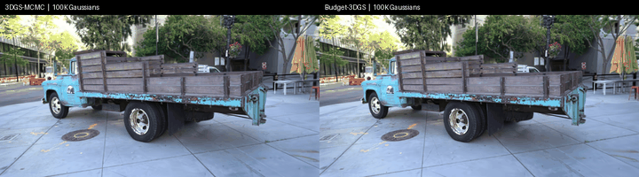
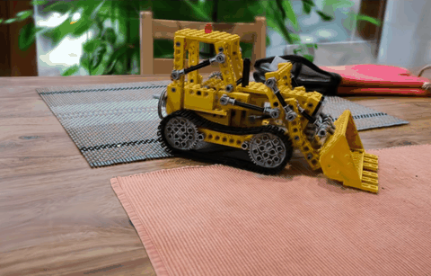
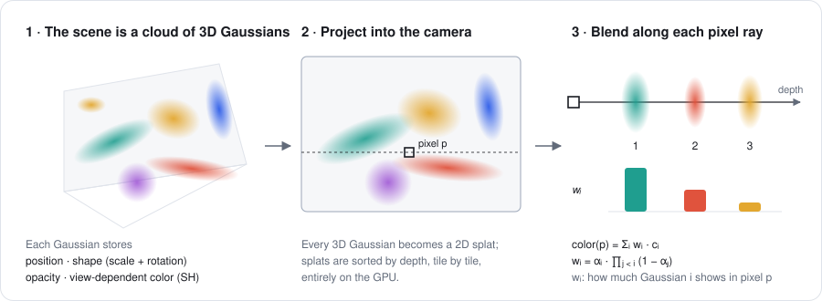
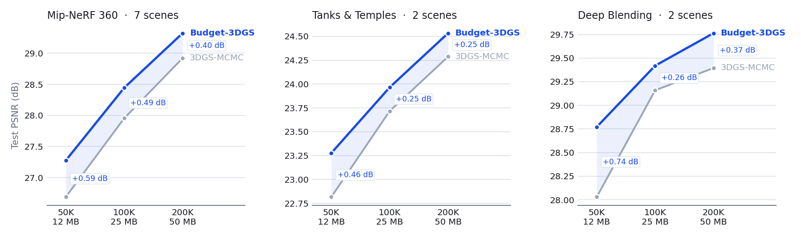

# Budget-3DGS

**Efficient 3D Gaussian splatting under a fixed memory budget.**

You set the number of Gaussians before training (50K Gaussians ≈ 12 MB), and training
never goes over it. Budget-3DGS builds on [3DGS-MCMC](https://ubc-vision.github.io/3dgs-mcmc/)
and changes one rule: which Gaussians get split. It spends the budget where the render
still misses detail.



* **Same memory, sharper scenes.** +0.37 to +0.59 dB average PSNR over 3DGS-MCMC, and
  better on all 11 standard scenes at 50K, 100K and 200K Gaussians.
* **Drop-in.** One extra loss term and a different sampling rule; +14% time per
  training step, same peak memory.
* **Runs on a 6 GB GPU.** Built on [gsplat](https://github.com/nerfstudio-project/gsplat);
  exports standard 3DGS `.ply` files.

## Interactive viewer

<p align="center"></p>

[`docs/viewer`](docs/viewer/index.html) renders the trained scenes in any browser with
WebGL2. It ships Garden, Kitchen and Truck at 50K Gaussians, with a 3DGS-MCMC and a
Budget-3DGS model for each. Press <kbd>M</kbd> to switch between them at the same
camera. Each model is a 12 MB `.ply` in [`docs/viewer/scenes`](docs/viewer/scenes),
which also opens in [SuperSplat](https://superspl.at/editor). You can drop your own
`.ply` onto the page.

```bash
python -m http.server -d docs/viewer 8000   # open http://localhost:8000
```

## How it works

<p align="center"></p>

With a fixed budget, 3DGS-MCMC reuses the slots of faded Gaussians by splitting a live
parent, chosen in proportion to its opacity. Budget-3DGS chooses the parent in
proportion to the variance of the render error inside its footprint. A Gaussian can
cancel the mean error with its own color, but not error that changes across its pixels.
That remaining error is detail it is too coarse to represent. The score is computed
exactly from the training backward pass. See [docs/method.md](docs/method.md) for the
derivation and ablations.

## Results



| Gaussians | Size | PSNR ↑ | SSIM ↑ | LPIPS ↓ |
|---:|---:|:---:|:---:|:---:|
| 50K | 12 MB | 26.23 → **26.82** | 0.829 → **0.836** | 0.298 → **0.293** |
| 100K | 25 MB | 27.40 → **27.81** | 0.865 → **0.868** | 0.241 → 0.241 |
| 200K | 50 MB | 28.16 → **28.53** | 0.888 → **0.889** | **0.199** → 0.202 |

3DGS-MCMC → Budget-3DGS, averaged over 7 Mip-NeRF 360, 2 Tanks & Temples and 2 Deep
Blending scenes, with every 8th image held out. The runs used a 6 GB GPU at half the usual
evaluation resolution, so compare these numbers with each other, not with published
tables. The 100K runs average two seeds, which differ by 0.08 dB. Per-scene results are
in [docs/assets/results.md](docs/assets/results.md).

## Quick start

```bash
conda create -n splat python=3.10 -y && conda activate splat
pip install torch==2.4.1 torchvision==0.19.1 --index-url https://download.pytorch.org/whl/cu124
pip install gsplat==1.5.3 --index-url https://docs.gsplat.studio/whl/pt24cu124 --extra-index-url https://pypi.org/simple
pip install -e '.[test]'

bash scripts/download_data.sh data   # Tanks & Temples, Deep Blending, Mip-NeRF 360 (~13 GB)
budget3dgs train --data data/360_v2/garden --images_dir images_8 --budget 100000 --output runs/garden
```

A run writes `point_cloud.ply` and `metrics.json` (PSNR, SSIM, LPIPS, FPS, time,
memory), plus renders of held-out views. `--method mcmc` trains the baseline. Any
undistorted COLMAP scene works as `--data`.

To run the full benchmark, use [`configs/gpu_6gb.json`](configs/gpu_6gb.json) (half
resolution, 50K–200K) or [`configs/gpu_24gb.json`](configs/gpu_24gb.json) (standard
resolution, 100K–1M, 3 seeds):

```bash
budget3dgs sweep --config configs/gpu_6gb.json --output runs/gpu_6gb --data_root data
budget3dgs report runs/gpu_6gb --output docs/assets
python scripts/export_viewer.py runs/gpu_6gb --scenes garden kitchen truck --budget 50000
```

## Repository

```
src/budget3dgs/   strategy.py (splitting rule), train.py, data.py, metrics.py, export.py, report.py, cli.py
scripts/           export_viewer.py, render_video.py, allocation_figure.py, probe_overhead.py, download_data.sh
docs/              viewer, method notes, figures and result tables
tests/             attribution exactness, budget and optimizer-state invariants
```

MIT License. Built on [gsplat](https://github.com/nerfstudio-project/gsplat); the viewer
uses [GaussianSplats3D](https://github.com/mkkellogg/GaussianSplats3D).
